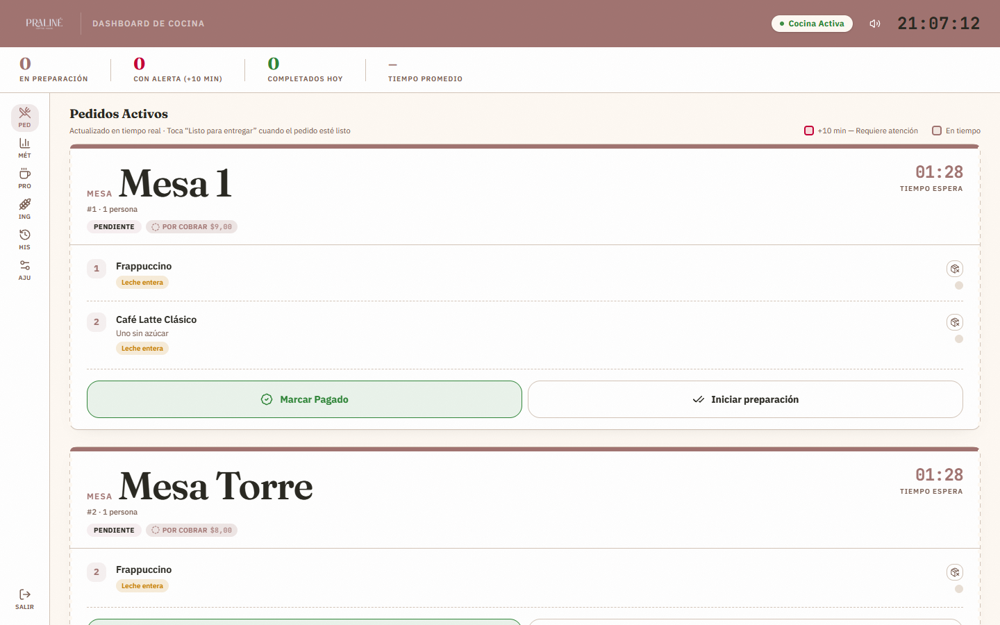
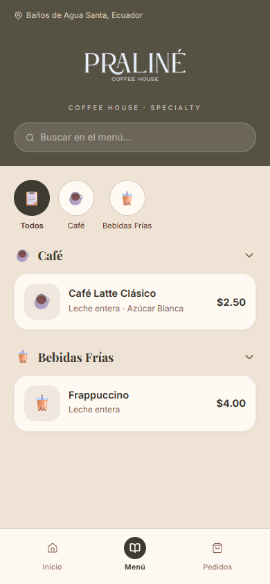
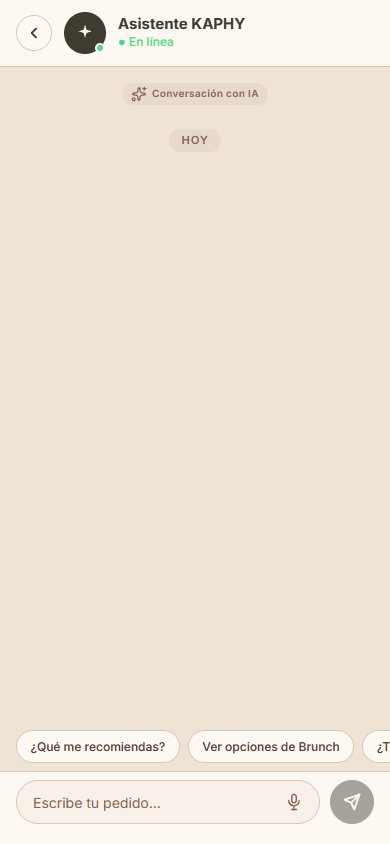

# ☕ KAPHIY - Ecosistema Digital para Praliné Coffee House

KAPHIY es un sistema digital de pedidos diseñado para transformar la experiencia del cliente en **Praliné Coffee House**, permitiendo realizar pedidos de forma rápida, intuitiva y sin fricción mediante tecnología web moderna.

---

## 📌 Descripción General

KAPHIY es una plataforma web que permite a los clientes:

- Escanear un código QR
- Acceder al menú digital sin instalar aplicaciones
- Realizar pedidos directamente desde su dispositivo móvil
- Reducir tiempos de espera y mejorar la atención

El sistema está diseñado bajo el concepto de **“cero fricción”**, eliminando barreras tecnológicas y optimizando la experiencia del usuario dentro del local.

---

## 🎯 Objetivo del Proyecto

Desarrollar un ecosistema digital que optimice la gestión de pedidos en Praliné Coffee House, mejorando la eficiencia operativa y ofreciendo una experiencia moderna, ágil y accesible para los clientes.

---

## 🚀 Características Principales

- 📱 Acceso mediante QR (sin descargas)
- ⚡ Aplicación Web Progresiva (PWA)
- 🧾 Gestión de pedidos en tiempo real
- 🧠 Integración futura con Inteligencia Artificial
- 🔊 Soporte para pedidos por voz (en desarrollo)
- 🔄 Automatización de procesos internos

---

## 🏗️ Arquitectura del Sistema

El ecosistema KAPHIY está compuesto por varios módulos:

### 🔹 Frontend
- Framework: Next.js
- Diseño orientado a móviles (Mobile First)
- Renderizado SSR para mejorar rendimiento

### 🔹 Backend
- Framework: NestJS
- API REST para gestión de pedidos
- Arquitectura modular y escalable

### 🔹 Base de Datos
- PostgreSQL (Neon Serverless)
- Modelo relacional para asegurar integridad de datos

### 🔹 Orquestación
- n8n (Self-Hosted)
- Automatización de flujos y eventos

### 🔹 Inteligencia Artificial
- Modelos de Lenguaje Avanzados (API)
- Procesamiento de lenguaje natural para asistencia al cliente

### 🔹 Infraestructura
- Oracle Cloud Infrastructure (OCI)
- Contenedores Docker (en implementación)

---

## 💡 Enfoque Tecnológico

El proyecto sigue principios clave de ingeniería de software:

- 🔓 Independencia tecnológica (evitar vendor lock-in)
- 💰 Optimización de costos (arquitectura serverless)
- ⚡ Alto rendimiento (SSR + APIs eficientes)
- 🔐 Seguridad (basado en OWASP)
- 📈 Escalabilidad progresiva

---

## 📸 Capturas

| Panel de cocina | Menú (app de clientes) | Asistente con IA |
|---|---|---|
|  |  |  |

Capturas tomadas con el sistema corriendo en local y los datos de ejemplo de `prisma/seed.ts`.

---

## 📊 Estado del Proyecto

El sistema se probó con Praliné Coffee House y se detuvo al evaluar su viabilidad económica. El backend que estaba desplegado ya no está en línea, por eso el panel publicado en Vercel no carga pedidos. Todo el sistema funciona en local siguiendo los pasos de abajo.

---

## ▶️ Ejecutar en local

Requisitos: Node.js 22 o superior y Docker.

1. Levantar una base de datos PostgreSQL:

```bash
docker run -d --name kaphiy-pg -e POSTGRES_USER=kaphiy -e POSTGRES_PASSWORD=kaphiy_local -e POSTGRES_DB=kaphiy -p 5433:5432 postgres:16-alpine
```

2. Backend (puerto 3001). En `backend/.env`, apuntar `DATABASE_URL` a esa base:

```bash
cd backend
npm ci
npx prisma db push
npx tsx prisma/seed.ts
npx tsx prisma/seed-barista.ts
npx nest start
```

`seed-barista.ts` crea el barista de turno; el PIN se define con `SEED_BARISTA_PIN` (ver el script).

3. Panel de cocina (puerto 3002) y app de clientes (puerto 3003), con `NEXT_PUBLIC_API_URL=http://localhost:3001`:

```bash
cd kaphiy-dashboard && npm ci && npx next dev -p 3002
cd kaphiy-pwa && npm ci && npx next dev -p 3003
```

> Nota: `prisma/migrations` solo contiene la migración inicial. El resto de cambios del esquema se aplicó directamente sobre la base, por eso en una base nueva se usa `prisma db push` en lugar de `prisma migrate deploy`.

---

## 👥 Equipo de Desarrollo

Proyecto desarrollado por el equipo **ARKASYS**:

- 👨‍💼 Gestión de proyecto
- 💻 Desarrollo Backend
- 🎨 Desarrollo Frontend
- 🤖 IA y documentación

---

## 📄 Contexto Académico

Este proyecto forma parte del proceso de formación en Ingeniería de Software, aplicando:

- Arquitectura de software
- Desarrollo web moderno
- Integración de servicios en la nube
- Buenas prácticas de desarrollo

---

## 🔮 Visión

KAPHIY busca posicionar a Praliné Coffee House como una marca innovadora, combinando tecnología y experiencia gastronómica para ofrecer un servicio moderno, eficiente y memorable.

---

## 📜 Licencia

Proyecto de uso académico.